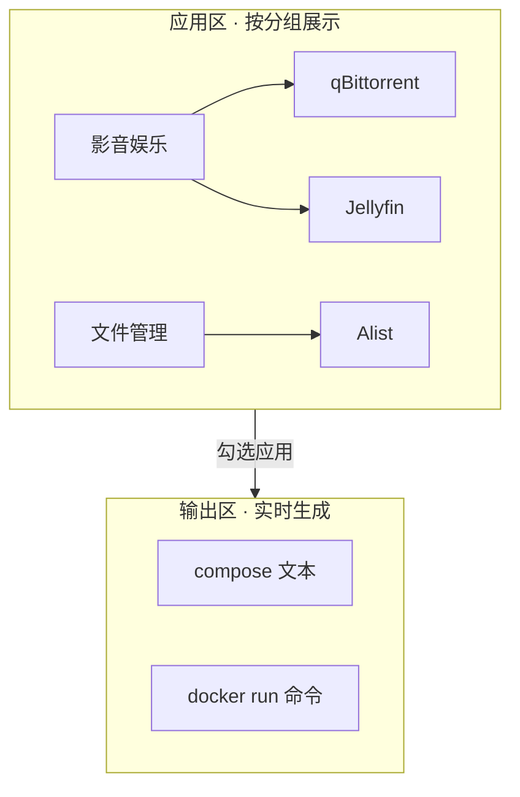

# 飞牛 FnOS Docker 部署生成器

> 一键筛选 20 款常用 Docker 应用，自定义主机 IP / 端口 / 映射路径，在线生成 `docker-compose.yml` 与 `docker run` 命令，复制即用。

## 项目简介

本工具面向飞牛 FnOS 用户，把 20 款高频 Docker 应用（下载、影音、网盘、智能家居、运维、监控等）的部署配置集中管理：

- 每个应用预置标准 compose 模板（含端口、数据卷、环境变量、重启策略）；
- 提供可交互 Web 页面，按需勾选、即时生成；
- 支持自定义主机 IP、Web 端口、数据根路径，自动适配 compose 与 docker run 两种形态；
- 支持自定义应用、拖拽排序、跨组移动、白天 / 黑夜主题。

## 在线体验

- 🌐 生成器主页（GitHub Pages）：<https://guanxiongfei.github.io/FNdocker/>
- 📖 图文使用说明页：<https://guanxiongfei.github.io/FNdocker/guide.html>
- 💻 仓库地址：<https://github.com/guanxiongfei/FNdocker>

## 核心特性

| 特性 | 说明 |
| --- | --- |
| 20 款应用 | 覆盖下载 / 影音 / 网盘 / 智能家居 / 运维 / 监控等场景 |
| 四类分组 | 影音娱乐、文件管理、生产工具、其他，可自定义增删 |
| 自定义应用 | 手动新增应用，可编辑名称、镜像、端口、卷、环境变量 |
| 灵活配置 | 主机 IP、Web 端口、数据根路径全局可改 |
| 双形态输出 | 同时生成 `docker-compose.yml` 与 `docker run` |
| 拖拽管理 | 应用支持排序与跨组拖拽，分组支持删除 |
| 主题切换 | 右上角一键切换白天 / 黑夜 |
| 本地持久化 | 配置保存在浏览器 localStorage，刷新不丢失 |

## 应用清单（20）

### 影音娱乐

| 应用 | 类别 | 默认 Web 端口 | compose 文件 |
| --- | --- | --- | --- |
| qBittorrent | 下载 | 8080 | `compose/qbittorrent.yml` |
| Transmission | 下载 | 9091 | `compose/transmission.yml` |
| Aria2 Pro | 下载 | 6888 | `compose/aria2.yml` |
| Jellyfin | 影音 | 8096 | `compose/jellyfin.yml` |
| Emby | 影音 | 8096 | `compose/emby.yml` |
| Plex | 影音 | 32400 | `compose/plex.yml` |
| Navidrome | 影音 | 4533 | `compose/navidrome.yml` |
| Immich | 照片 | 2283 | `compose/immich.yml` |
| PhotoPrism | 照片 | 2342 | `compose/photoprism.yml` |

### 文件管理

| 应用 | 类别 | 默认 Web 端口 | compose 文件 |
| --- | --- | --- | --- |
| Alist | 网盘 | 5244 | `compose/alist.yml` |
| Nextcloud | 网盘 | 80 | `compose/nextcloud.yml` |
| File Browser | 文件 | 80 | `compose/filebrowser.yml` |

### 生产工具

| 应用 | 类别 | 默认 Web 端口 | compose 文件 |
| --- | --- | --- | --- |
| Home Assistant | 智能家居 | 8123 | `compose/homeassistant.yml` |
| Vaultwarden | 密码管理 | 80 | `compose/vaultwarden.yml` |
| Memos | 笔记 | 5230 | `compose/memos.yml` |
| Uptime Kuma | 监控 | 3001 | `compose/uptimekuma.yml` |
| Portainer | 运维 | 9000 | `compose/portainer.yml` |
| Nginx Proxy Manager | 运维 | 81 | `compose/nginxproxymanager.yml` |
| AdGuard Home | 网络 | 3000 | `compose/adguardhome.yml` |

### 其他

| 应用 | 类别 | 默认 Web 端口 | compose 文件 |
| --- | --- | --- | --- |
| Heimdall | 导航 | 7990 | `compose/heimdall.yml` |

## 工作流程


## 界面布局示意



## 使用指南

### 1. 快速开始
打开 [生成器主页](https://guanxiongfei.github.io/FNdocker/)（或本地用浏览器直接打开 `index.html`）。页面默认按四类分组展示全部 20 款应用。

### 2. 分类筛选与勾选
点击分组标题展开 / 收起；勾选应用前的复选框即可将其加入「已选清单」。顶部提供搜索框，可按名称快速定位应用。

### 3. 自定义主机 IP / 端口 / 路径
在全局设置区填写：

- **主机 IP**（如 `192.168.1.100`）：用于 `docker run` 的 `-p IP:端口:端口` 绑定；
- **数据根目录**（如 `/vol1/1000/docker`）：所有卷映射的前缀；
- 各应用 **Web 端口** 可单独修改，生成结果实时刷新。

### 4. 自定义应用
点击分组内「+ 自定义应用」，填写名称、镜像、端口、卷、环境变量，保存后即出现在该分组中，可像内置应用一样勾选与生成。自定义应用保存在本地浏览器。

### 5. 拖拽排序与跨组移动
长按拖拽应用卡片：

- 在同组内上下拖动可调整顺序；
- 拖到另一个分组区域可跨组移动；
- 拖到分组标题的删除区可删除分组（分组内应用自动回到「其他」）。

### 6. 白天 / 黑夜主题
右上角按钮一键切换。浅色主题下标题栏同步变为浅色背景，配置自动记忆。

### 7. 生成 compose 与 docker run
勾选完成后，点击「生成」：

- 右侧输出 compose 文本（多服务应用自动加入 `fnos_net` 公共网络，如 Immich 的 server / db / redis）；
- 同时输出等价的 `docker run` 命令，并按容器名自动排序，结果区不横向溢出，便于整段复制。

### 8. 部署到飞牛 FnOS
将生成的 compose 内容保存为 `docker-compose.yml`，在飞牛终端执行：

```bash
# 方式一：compose（使用页面生成的完整文件）
docker compose up -d

# 方式二：单应用（使用仓库预置文件）
cd compose
docker compose -f qbittorrent.yml up -d
```

部署后访问 `http://<主机IP>:<Web端口>` 即可使用对应服务。

## 本地生成与开发

仓库内置生成脚本，可重新生成 `index.html` 与 20 个 `compose/*.yml`：

```bash
cd fnos-docker
python generate.py
```

> 说明：`generate.py` 仅在仓库缺少 `README.md` 时生成默认清单；本文件为手工维护的图文说明，不会被脚本覆盖。

## 目录结构

```
fnos-docker/
├── index.html          # 可交互生成器（已生成）
├── template.html       # 生成器 HTML 模板
├── generate.py         # 数据模型 + 生成脚本
├── README.md           # 本文档（图文说明）
├── guide.html          # 独立图文使用说明页
└── compose/            # 20 个独立 compose 文件
    ├── qbittorrent.yml
    ├── jellyfin.yml
    └── ...（共 20 个）
```

## 说明

- 默认数据根目录 `/vol1/1000/docker` 适用于飞牛 FnOS 典型存储布局，请按实际挂载点修改。
- 涉及特权模式（如 Home Assistant）或宿主 socket 挂载（如 Portainer）的应用，请确认飞牛 FnOS 的 Docker 权限设置。
- 所有配置仅保存在你本地浏览器，不会上传任何数据。
